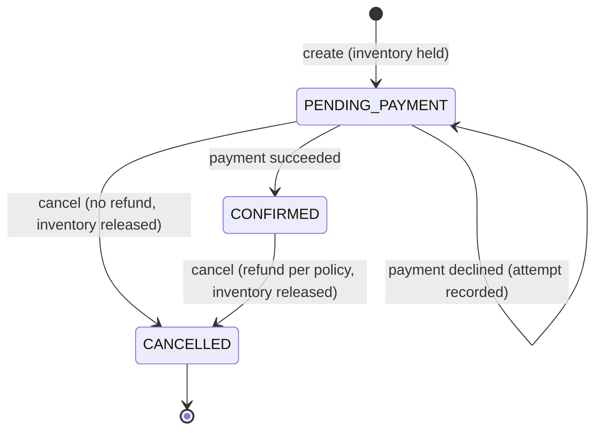

# Hotel Booking Service

Backend for a hotel booking platform. Rupeek SDE-3 machine coding round, Question A.

Guests **discover** available properties, **book** a room type for a date range, **pay**, and
can **cancel** for a policy-based refund. Owners **onboard** one or many properties.

> **Stack note:** the brief asks for Java/Spring Boot. Python was approved by the recruiter.
> This is Python 3.12 + FastAPI, with the same layering a Spring service would have
> (domain / application services / ports / adapters / controllers).

---

## Quick start

Requires [uv](https://docs.astral.sh/uv/) (it installs Python 3.12 if needed).

```bash
make install       # uv sync
make run           # http://localhost:8000/docs, with demo data seeded
make test          # 237 tests: unit, service, API, concurrency
make lint          # ruff + mypy --strict
```

| Variable | Default | Effect |
|---|---|---|
| `SEED_DEMO_DATA` | `false` (`make run` sets `true`) | Seeds a hotel chain with 3 properties (Bengaluru, Goa) and a standalone homestay |
| `PRICING_STRATEGY` | `standard` | `standard` or `weekend` (+20% on Fri/Sat nights). `make run-weekend` sets it |

Swagger UI at **`/docs`** has every endpoint, schema and error response.

### Try it

```bash
B=http://localhost:8000

# 1. Discover. Returns only room types free on every night of the stay, cheapest first.
curl "$B/properties/search?city=Bengaluru&check_in=2026-12-04&check_out=2026-12-06&guests=2&amenities=wifi&min_rating=4"

# 2. Book: copy property_id / room_type_id from the search result. Holds inventory, status pending_payment.
curl -X POST $B/bookings -H 'content-type: application/json' -d '{
  "property_id": "<id>", "room_type_id": "<id>", "guest_name": "Asha",
  "check_in": "2026-12-04", "check_out": "2026-12-06", "guests": 2 }'

# 3. Pay. Success -> 201 and booking confirmed. Decline -> 402 and booking stays pending (retry allowed).
curl -X POST $B/bookings/<booking_id>/payments -H 'content-type: application/json' \
  -H 'Idempotency-Key: 7f9c-demo' -d '{"method": "upi", "details": {"vpa": "asha@okhdfc"}}'

# 4. Cancel: refunds per the property's policy and frees the rooms.
curl -X POST $B/bookings/<booking_id>/cancel
```

Mock gateway test instruments:

| Method | Approved | Declined |
|---|---|---|
| `card` | `{"card_number": "4242424242424242", "cvv": "123"}` | `card_number: 4000000000000002` |
| `upi` | `{"vpa": "anyone@okhdfc"}` | `vpa: fail@upi` |
| `wallet` | `{"provider": "paytm", "phone": "9876543210"}` | `phone: 9000000000` (paytm) |

### API

| Method | Path | Purpose |
|---|---|---|
| `POST` | `/owners` | Register an owner (`individual` or `chain`) |
| `GET` | `/owners/{id}` | Owner with its property ids |
| `POST` | `/owners/{id}/properties` | Onboard a property with room types, pricing, amenities, cancellation policy |
| `GET` | `/owners/{id}/properties` | All properties of an owner |
| `GET` | `/properties/search` | Availability search with filters |
| `GET` | `/properties/{id}` | Property details |
| `POST` | `/bookings` | Create a booking (holds inventory) |
| `GET` | `/bookings/{id}` | Booking details |
| `POST` | `/bookings/{id}/payments` | Pay (optional `Idempotency-Key` header) |
| `GET` | `/bookings/{id}/payments` | All payment attempts, failed ones included |
| `POST` | `/bookings/{id}/cancel` | Cancel and refund |

Errors are always `{"error": "<DomainErrorName>", "message": "..."}`:

| Status | Meaning |
|---|---|
| 422 | Validation failed |
| 404 | Not found |
| 409 | Sold out, invalid state change, or idempotency key reused |
| 402 | Payment declined |
| 502 | Gateway refused the refund |

---

## Design

### Layers

```
app/
├── domain/          Entities and value objects. Plain Python, no framework imports.
├── ports/           Interfaces: repositories, PaymentGateway, PricingStrategy,
│                    CancellationPolicy, SearchFilter, Clock, LockProvider
├── application/     Use-case services. They depend only on ports.
├── strategies/      Pluggable implementations: filters, payment methods, pricing, policies
├── infrastructure/  Adapters: in-memory repositories, mock gateway, keyed locks, clocks
└── api/             FastAPI routers, request/response schemas, error mapping,
                     and container.py (the composition root)
```

Dependencies only point inward. `domain` imports nothing from the other layers. `application`
sees only `ports` and `domain`. The **only** place concrete classes are chosen is
`api/container.py`. Tests build a `Container` with a `FixedClock` or a misbehaving gateway
the same way.

### Domain model

```
OwnerAccount 1──* Property 1──* RoomType ──1 RoomInventory (booked units per night)
                                    │
Booking ──(property, room type, DateRange, guests, rooms, total, policy snapshot)
   └──1 Payment (succeeded | failed | partially_refunded | refunded), with failed attempts kept
```

- **Value objects:**
  - `Money` uses `Decimal`, rounds to 2 places, can't be negative, and won't mix currencies.
  - `DateRange` covers the nights from check-in up to, but not including, check-out. So a
    check-out day can be someone else's check-in.
  - `Location` and `Quote` are also value objects.
- **Single vs multi-property owner (§3.2):** an `OwnerAccount` owns a list of properties. A
  standalone hotel is just an owner with one property and goes through the same code path.
  `account_type` only describes the account.
- **Inventory:** each room type has N identical units, with a count of booked units per night.
  Free units for a stay = total − the busiest night. This makes overlap checks and
  double-booking prevention one rule.

### Booking lifecycle



All allowed transitions are in one table (`domain/booking/status.py`). Any other transition
raises `InvalidStateTransitionError` (409). The gateway is never called for a booking that
isn't payable or cancellable: the domain guard runs first.

### Extension points (open/closed)

| To add… | Implement | Register in | Untouched |
|---|---|---|---|
| A search filter | `SearchFilter.matches(offer)` | `SearchQuery.to_filters()` | `SearchService` |
| A payment method | `PaymentMethod.parse(details)` | `default_payment_methods()` | `PaymentService`, API schema |
| A payment provider | `PaymentGateway` | `Container.gateway` | everything else |
| A pricing strategy | `PricingStrategy.quote(...)` | `PRICING_STRATEGIES` | search, booking |
| A cancellation policy | a `TieredRefundPolicy` tier table, or `CancellationPolicy` | `default_cancellation_policies()` | `CancellationService` |
| A real database | the repository ABCs in `ports/repositories.py` | `Container` | services |

Search and booking use the same `PricingStrategy`, so the price a guest sees is the price
charged. The tests include a custom filter and a custom tier table to show these extensions
need no change to the services.

### Concurrency

- **Inventory:** `InventoryAllocator` is the only code that changes inventory. Each
  reserve or release reads, checks and writes under a lock keyed by
  `(property, room type)`. Different room types never wait on each other.
- **Booking lifecycle:** payment and cancellation both run under a per-booking lock. A payment
  can't confirm a booking that is being cancelled, and a double-click on cancel doesn't refund
  twice.
- **Lock order** (no deadlocks): idempotency key → booking → inventory (`application/lock_keys.py`).
- **Search** reads without locks. A result can sell out before it's booked; booking re-checks
  under the lock, so it can never double-book.
- **Tests that can actually fail.** The plain in-memory repo hands every thread the same object,
  and the GIL then hides the race: the first version of the test passed even with locks
  removed. The concurrency tests now use a database-like repo (each read returns a copy after
  some delay) or a slow gateway. A **control test** turns locks off and asserts that overselling
  happens. With locks on, 50 threads racing for 3 units always book exactly 3.

### Idempotency (payments)

Clients send `Idempotency-Key`. The first request stores `key → (request fingerprint,
payment id)`, and this happens under a lock on that key:

- Same key and same body: returns the original result with `Idempotent-Replayed: true`.
  Nothing is charged.
- Same key with a different body: 409.
- A declined attempt replays as a decline, as Stripe does, so a retry needs a fresh key.

---

## Assumptions

- **Inventory:** counted per room type (N identical units), not per physical room number.
- **Check-in:** at 14:00 on the check-in date. Refund windows are measured up to then, and
  cancelling at or after check-in is rejected.
- **Unpaid bookings:** they hold inventory until cancelled. There is no automatic hold expiry
  (see below).
- **Cancellation policy:** each booking keeps a copy of the property's policy at booking time,
  so later policy changes never change existing bookings.
- **Payments:** a booking is paid in full in one payment and refunded at most once. Amounts
  are in INR.
- **Single process:** locks are in-process. All times are naive local time from an injected
  `Clock`.
- **No auth:** owner and guest identity is whatever the caller sends (out of scope per §8).

## Trade-offs

- **Booking lock held during the gateway call.** This is simple and correct with a fast mock.
  Against a real provider, I'd record a `PENDING` payment, release the lock, and settle the
  result from a webhook or polling, so slow gateways don't block other requests on that booking.
- **Plain dict for payment `details`, not a typed union per method.** OpenAPI documents it less
  precisely, but a new method needs no API change. Each method validates its own fields.
- **Locks and idempotency keys are never evicted.** Fine in memory. In production I'd use
  short-lived keys with a TTL.
- **The per-night count model** handles any stay length and partial overlaps. Scanning nights
  is O(nights), which is fine with stays capped at 30.

## With more time

1. **Hold expiry:** expire `PENDING_PAYMENT` bookings after ~15 min (a new `EXPIRED` state) so
   abandoned checkouts free their rooms.
2. **Real persistence:** a Postgres adapter for the repository interfaces, using row locks
   (`SELECT … FOR UPDATE`) or optimistic versioning on inventory rows instead of in-process
   locks. The locking interface would then be backed by the database or Redis.
3. **Asynchronous payments:** payment intents, gateway webhooks, and an outbox for the events
   `BookingConfirmed` and `BookingCancelled`.
4. **Search:** pagination and sorting options, and a read-optimised availability index instead
   of scanning every property in a city.
5. **More:** time-zone-aware property check-in times, partial cancellation (fewer rooms or
   nights), auth and owner-scoped endpoints, observability.

## Tests

`make test` runs 237 tests in about 1 second.

| Folder | What it covers |
|---|---|
| `tests/unit/domain` | Value objects, entity rules, every valid and invalid booking transition, inventory overlap and back-to-back stays |
| `tests/unit/strategies` | Each filter, payment method, pricing strategy and refund tier, including boundaries |
| `tests/unit/application` | Services wired to in-memory adapters with a fixed clock. Covers state changes driven by payment results, refunds, inventory release, guards and failure paths |
| `tests/concurrency` | Booking races with a database-like repo, plus the no-lock control test |
| `tests/api` | HTTP contract: status codes, error mapping, and full book → pay → cancel → rebook flows |
